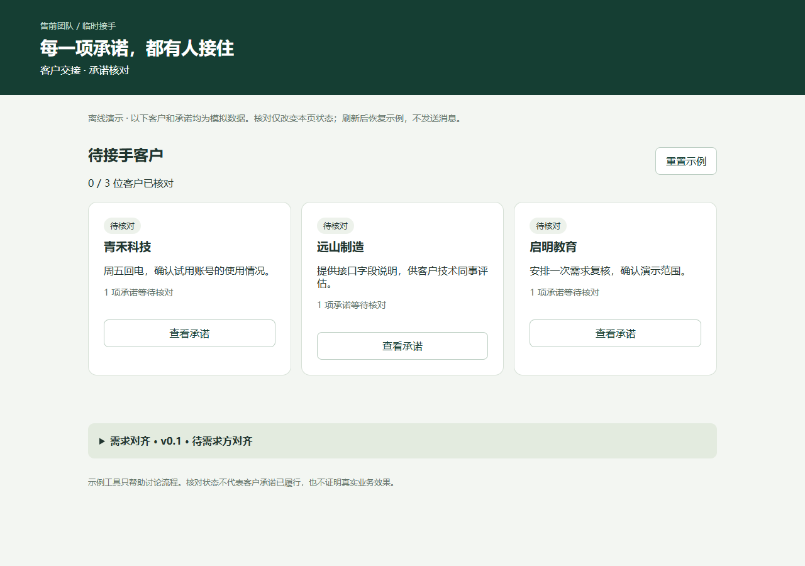

# idea-to-demo · 从想法到对齐 Demo

A Codex skill that turns rough ideas into interactive HTML demos through guided discovery, reusable SOPs, and traceable stakeholder feedback.

**描述想法 → 逐步澄清 → 选择 SOP → 制作可交互 Demo → 收集反馈 → 继续修改。**

适合需要与负责人、客户或其他需求方讨论方案的人。你不必先写完整PRD，也不必先学方法编号。Skill根据当前未知选择问题，复用已有回答，最终交付能实际操作的HTML原型及对齐记录。

版本：**0.1.0 · 试用版**。由 [geekwong-tech](https://github.com/geekwong-tech) 维护。语言以中文为主，输出语言可按用户要求调整。



截图来自[客户交接示例](examples/customer-handoff/demo.html)，全部客户和承诺均为模拟数据。下载HTML后可直接打开；GitHub文件预览不会执行页面脚本。

## 快速开始

1. 从 [Releases](https://github.com/geekwong-tech/idea-to-demo/releases) 下载 `idea-to-demo-0.1.0.zip` 并解压。
2. 把整个 `idea-to-demo` 文件夹放到**一个**位置：
   - 个人使用：`~/.agents/skills/idea-to-demo/`。
   - 仅当前项目：`你的项目/.agents/skills/idea-to-demo/`。
3. 在Codex中打开实际需求项目，输入下面的任务。若Skill未出现，检查目录中是否直接有 `SKILL.md`，必要时重启Codex。

```text
用 $idea-to-demo 帮我把这个想法做成能与需求方对齐的HTML Demo。
我的想法是：……
请按合适的SOP逐步提问，不要一次给我整份问卷。
```

安装、更新、移除以及 Git 安装方式见[安装说明](docs/installation.md)。Codex发现与调用规则参考[OpenAI官方文档](https://learn.chatgpt.com/docs/build-skills)。本Skill无需其他自定义Skill、连接器或额外API密钥；生成与文件操作使用你已有的Codex环境。

## 它怎样带你推进

| 你的情况 | Skill的处理 |
| --- | --- |
| “有个想法，暂时说不清” | 从最近情境、目标用户、替代方案与损失开始，每轮通常1–3问 |
| “已有确认需求，只要Demo” | 复用材料，从范围及缺口检查进入，不重做整套访谈 |
| “先按假设出一版看看” | 明确标记探索假设，生成可用于讨论或取证的场景 |
| “客户看完后改了用户角色” | 追踪角色变化对流程、权限、需求与验收的影响，再修改 |
| “问题在协作职责，不想新增系统” | 用流程/责任方法整理，按需做流程走读HTML或业务文档 |

14项SOP涵盖问题简报、行为访谈、最小实验、构建决策、范围验收、上下文交接、环境验证、分层检查、价值度量、增长、复盘、团队协作、方法演进和项目队列。**按需选择，不要求走完全部方法。**详见[方法路由](references/routing.md)。

## 你会得到什么

默认保存在当前项目 `alignment/`，可以指定其他目录：

| 文件 | 用途 |
| --- | --- |
| `demo.html` | 默认离线单文件，可操作业务场景、异常提示、返回/重置；独立需求对齐区提供假设、待确认项和反馈下载 |
| `brief.md` | 问题与回答、证据与未知、SOP选择、需求与Demo场景的对应关系 |
| `review.md` | 演示步骤、待决定事项、实际验证范围、反馈及修改历史 |

明确只要一个文件时，必要对齐与接续信息可合并进HTML。生成结果会因需求与Codex环境不同而变化；本仓库提供指导与方法，不是固定界面模板或托管服务。

## 跟需求方对齐后

把HTML交给需求方演示，让对方在“需求对齐”区填写并下载意见。反馈文件不会自动发送，也没有团队共享后台。将文件交回Codex：

```text
继续用 $idea-to-demo。产物在 alignment/，反馈文件在 feedback.json。
请先检查反馈对应的版本，说明哪些需求和场景受影响，再修改Demo。
保留冲突意见和仍未决定的问题。
```

**Demo完成、需求方确认、业务效果验证分别记录。**模拟AI、合成数据和未实现的外部操作需要标明；不因页面能操作就宣称需求已验证。无浏览器能力时交付应标为未浏览器验证的草稿。

## 验证与边界

初版经过五类独立行为试用、一次真实HTML生成与Edge浏览器测试；试用发现的通用SOP与原型前提冲突已调整并做行为复验。完整生成样例发生在适配修订前，不能视为最终文本所有路径的端到端覆盖。没有真实团队采用、客户访谈或业务收益证据。[验证范围](docs/validation.md)

本Skill负责需求探索与原型对齐，不默认接生产系统、发送外部消息、部署、启动真实审批或替需求方作决定。

## 来源、维护与许可

- [方法来源与归属说明](ATTRIBUTION.md)：SOP为对手册原则的操作化设计，原始手册未随仓库分发。
- [贡献说明](CONTRIBUTING.md)：欢迎提交可复现问题、具体场景和改进建议，请用合成或脱敏材料。
- [更新记录](CHANGELOG.md) · [发布记录](https://github.com/geekwong-tech/idea-to-demo/releases)。
- 许可状态见[许可说明](LICENSE-NOTICE.md)。
